# Kubernetes beyond the basics

## RBAC

 

Fabrice Jammes, Karim Ammous, https://k8s-school.fr

---

# Securing the API server with RBAC

---

## Location in the API server

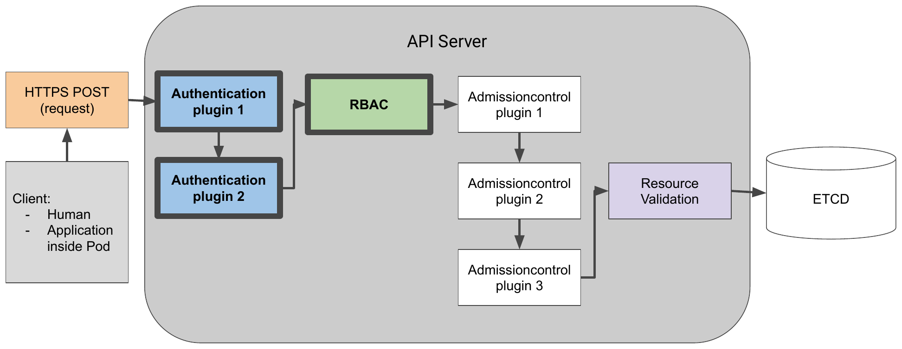

---

## Authentication

Multiple authentication plugins:

- Client certificate
- Authentication token passed in an HTTP header
- Basic HTTP authentication
- [int128/kubelogin](https://github.com/int128/kubelogin): kubectl plugin for Kubernetes OpenID Connect authentication (`kubectl oidc-login`)
- Others, see Dex: https://github.com/dexidp/dex

---

## Users

2 kinds of clients for the API server:

- Actual humans: **users**
- Applications running inside Pods: **ServiceAccounts**

---

## Groups

The authentication plugin returns:

- **groups** (as arbitrary strings)
- **username**
- **user ID**

Human users and ServiceAccounts belong to one or more groups.

Groups allow to grant permissions to several users at once.

---

## Built-in groups

- **system:unauthenticated**: none of the authentication plugins could authenticate the client.
- **system:authenticated**: assigned to a user who was authenticated successfully.
- **system:serviceaccounts**: all ServiceAccounts.
- **system:serviceaccounts:&lt;namespace&gt;**: all ServiceAccounts in a specific namespace.

---

## ServiceAccounts

**Name:**

```
system:serviceaccount:<namespace>:<service account name>
```

**Authentication token:**

```
/var/run/secrets/kubernetes.io/serviceaccount/token
```

May be stored inside a k8s Secret.

---

## ServiceAccounts

Changes in k8s 1.24: [upgrade notes](https://github.com/kubernetes/kubernetes/blob/master/CHANGELOG/CHANGELOG-1.24.md#urgent-upgrade-notes), [service account token Secrets](https://kubernetes.io/docs/concepts/configuration/secret/#service-account-token-secrets)

```console
$ kubectl create sa foo
serviceaccount/foo created
$ kubectl describe sa foo
Name:                foo
Namespace:           default
Labels:              <none>
Annotations:         <none>
Image pull secrets:  <none>
Mountable secrets:   <none>
Tokens:              <none>
Events:              <none>
```

---

## Secrets

Since Kubernetes 1.24, ServiceAccount token Secrets are no longer generated automatically: the tokens are obtained through the [TokenRequest API](https://kubernetes.io/docs/reference/kubernetes-api/authentication-resources/token-request-v1/).

A long-lived token, if really needed:

```yaml
cat <<EOF | kubectl apply -f -
apiVersion: v1
kind: Secret
metadata:
  name: foo-token
  annotations:
    kubernetes.io/service-account.name: foo
type: kubernetes.io/service-account-token
EOF
```

---

## Secrets

```console
$ kubectl describe secret foo-token
Name:         foo-token
Namespace:    default
Labels:       <none>
Annotations:  kubernetes.io/service-account.name: foo
              kubernetes.io/service-account.uid: 2d3e24e0-0cc3-408d-a3cd-ef8e8b4efa38

Type:  kubernetes.io/service-account-token

Data
====
namespace:  7 bytes
token:      eyJhbGciOiJSUzI1NiIsImtpZCI6IkdsV...     # JWT token
ca.crt:     1099 bytes
```

---

## Each pod is associated with exactly one ServiceAccount

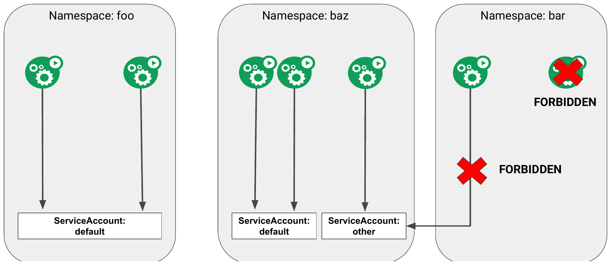

---

## ServiceAccounts: mountable Secrets

ServiceAccount annotation:

```
kubernetes.io/enforce-mountable-secrets="true"
```

=> the pods using this ServiceAccount can mount only the ServiceAccount's mountable Secrets.

---

## ServiceAccounts: image pull Secrets

```yaml
apiVersion: v1
kind: ServiceAccount
metadata:
  name: my-service-account
imagePullSecrets:
- name: my-dockerhub-secret
```

Adding image pull Secrets to a ServiceAccount saves you from having to add them to each pod individually.

---

## A pod with a custom ServiceAccount

This pod uses the `foo` ServiceAccount instead of the default one.

<pre><code>apiVersion: v1
kind: Pod
metadata:
  name: curl-custom-sa
spec:
<b>  serviceAccountName: foo</b>
  containers:
  - name: main
    image: curlimages/curl
    command: ["sleep", "9999999"]
  - name: ambassador
    image: k8sschool/kubectl-proxy:1.2x.x
</code></pre>

---

## The kubectl-proxy application behaviour

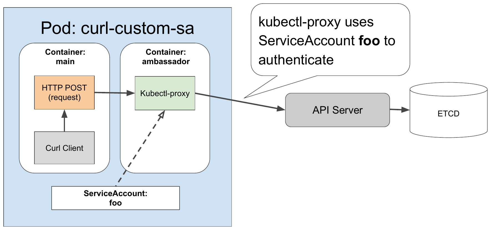

---

## Exercise: play with kubectl proxy

1. Launch kubectl proxy

```console
kubectl proxy &
```

2. List the pods of a given namespace with curl

```console
curl http://localhost:8001/XXXXXXX
```

Lab: [kubectl proxy](https://k8s-school.fr/labs/k8s/en/1_labs/kubectl-proxy/index.html)

---

## RBAC

RBAC authorization rules: configured through **four API objects**

- **Roles / ClusterRoles**: specify which verbs can be performed on which resources.
- **RoleBindings / ClusterRoleBindings**: bind the above roles to specific users, groups, or ServiceAccounts.

---

## RBAC: ROLES what can be done; BINDINGS who can do it

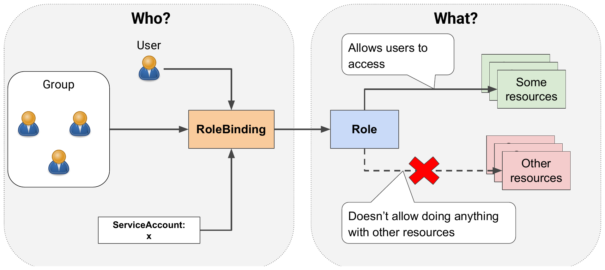

---

## RBAC: mapping HTTP methods to authorization verbs

| HTTP method | Verb for a single resource | Verb for a collection |
|---|---|---|
| GET, HEAD | get (and watch for watching) | list (and watch) |
| POST | create | n/a |
| PUT | update | n/a |
| PATCH | patch | n/a |
| DELETE | delete | deletecollection |

---

## Roles/RoleBindings: namespaced; ClusterRoles/ClusterRoleBindings: cluster-level

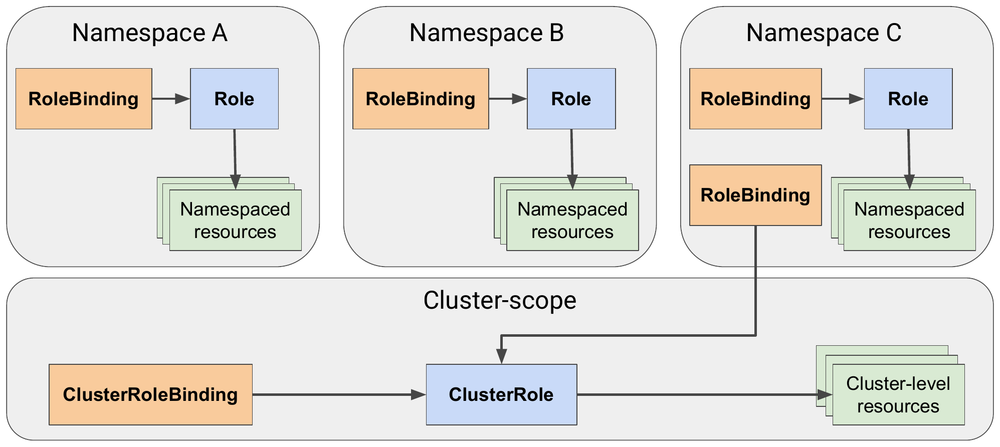

---

## Role "service-reader" allows getting and listing Services in the foo namespace

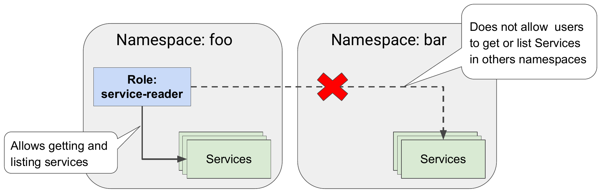

---

## RoleBinding "test" binds ServiceAccount "default" with Role "service-reader"

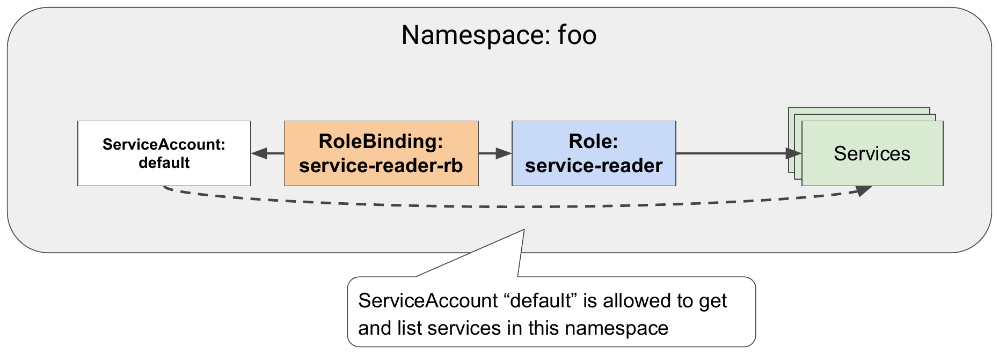

---

## Exercise 1

- Create 2 namespaces, `foo-<ID>` and `bar-<ID>`
- Create a kubectl-proxy pod inside `foo-<ID>`, which uses the service account `foo-<ID>:default` (the `default` service account of the namespace `foo-<ID>`). [YAML example](https://raw.githubusercontent.com/k8s-school/k8s-advanced/master/labs/2_authorization/kubectl-proxy.yaml)
- Create a service inside the namespaces `foo-<ID>` and `bar-<ID>` (`kubectl create service --help`)
- Run curl inside the container `kubectl-proxy/main` against the API server service URL for the namespaces foo and bar (example: `http://localhost:8001/api/v1/namespaces/default/services`)
- Inside the namespace `foo-<ID>`, create a role `service-reader`, and a rolebinding for the service account `foo-<ID>:default`
- Run curl inside the container `kubectl-proxy/main` against the API server service URL for the namespaces `foo-<ID>` and `bar-<ID>`
- Check https://github.com/k8s-school/k8s-advanced/tree/master/labs/2_authorization

---

## A RoleBinding binding ServiceAccounts from two namespaces to the same Role

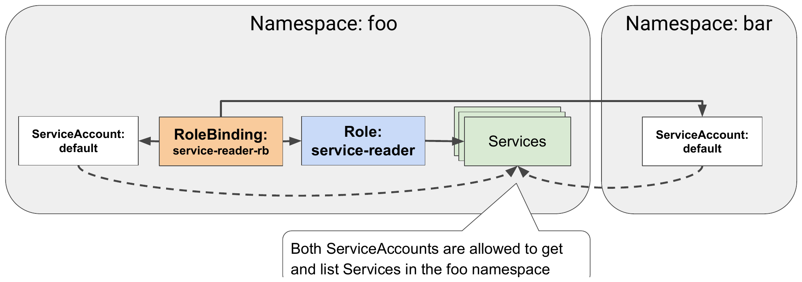

Solution: https://github.com/k8s-school/k8s-advanced/blob/master/labs/2_authorization/2_RBAC_role.sh

---

## RoleBinding + ClusterRole: does not grant access to cluster-level resources

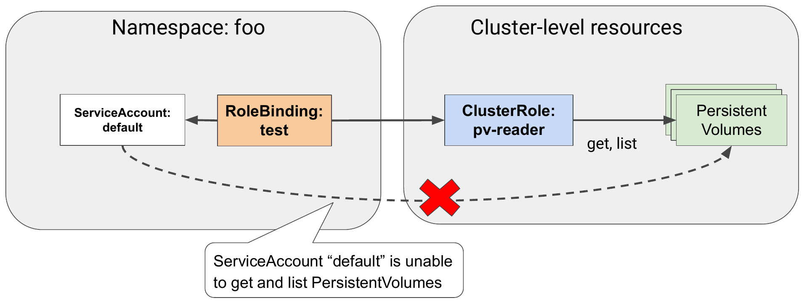

---

## ClusterRoleBinding + ClusterRole: grants access to cluster-level resources

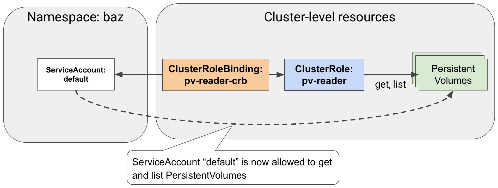

---

## ClusterRoleBinding + ClusterRole: grants permissions across all namespaces

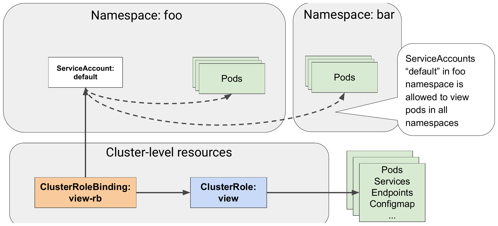

---

## RoleBinding + ClusterRole: only grants access to the resources of the RoleBinding's namespace

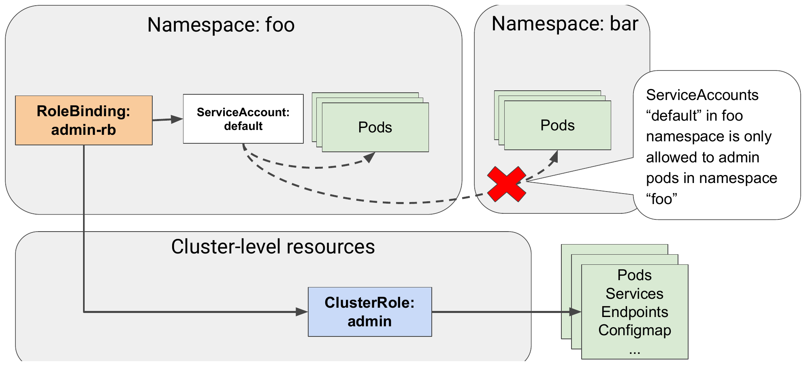

---

## RBAC: privilege escalation via pod creation

See https://kubernetes.io/docs/reference/access-authn-authz/authorization/#privilege-escalation-via-pod-creation

**Caution:** System administrators, use care when granting access to pod creation. A user **granted permission to create pods** (or controllers that create pods) in the namespace can: **read all secrets in the namespace; read all configmaps in the namespace; and impersonate any service account** in the namespace and take any action the account could take. This applies regardless of authorization mode.

---

## RBAC: specific combinations of roles and bindings types

| For accessing | Role type to use | Binding type to use |
|---|---|---|
| Cluster-level resources (Nodes, PersistentVolumes, ...) | ClusterRole | ClusterRoleBinding |
| Non-resource URLs (`/api`, `/healthz`, ...) | ClusterRole | ClusterRoleBinding |
| Namespaced resources in any namespace, and across all namespaces | ClusterRole | ClusterRoleBinding |
| Namespaced resources in a specific namespace (**reusing the same ClusterRole in multiple namespaces**) | ClusterRole | RoleBinding |
| Namespaced resources in a specific namespace (the Role must be defined in each namespace) | Role | RoleBinding |

---

# Default ClusterRoles and ClusterRoleBindings

---

## Listing all ClusterRoleBindings and ClusterRoles

```console
$ kubectl get clusterrolebindings
$ kubectl get clusterroles
```

The most important roles are the **view**, **edit**, **admin**, and **cluster-admin** ClusterRoles.

They're meant to be bound to ServiceAccounts used by user-defined pods.

---

# RBAC monitoring tools

---

## RBAC monitoring tools

- Built-in: `kubectl auth can-i`

```console
$ kubectl [--as=user/sa] auth can-i create pod
yes
```

- Trivy (Aqua): https://github.com/aquasecurity/trivy

```console
trivy k8s --scanners rbac --disable-node-collector --report all --timeout 15m
```

- [Kubescape](https://github.com/kubescape/kubescape)

Still working, but without active maintenance:

- [rbac-tool](https://github.com/alcideio/rbac-tool): visualize, analyze, generate and query
- [Rakkess](https://github.com/corneliusweig/rakkess): lists the RBAC permissions in kubectl output

---

## Kubescape succeeds!

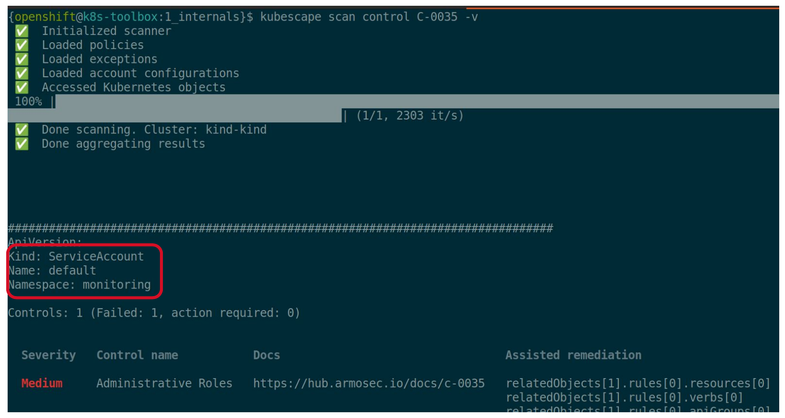

---

## Security dashboard

[Aqua Security: CSPM security graph](https://www.aquasec.com/wp-content/uploads/2023/05/CSPM_Sec-graph_160523_V4.jpg)

---

# Summary

---

## What we have seen

- Clients of the API server include both human users and applications running in pods.
- Applications in pods are associated with a **ServiceAccount**.
- Both users and ServiceAccounts are associated with **groups**.
- By default, pods run under the **default ServiceAccount**, created automatically for each namespace.
- Additional ServiceAccounts can be created manually and associated with a pod.
- ServiceAccounts can be configured to allow mounting only a **constrained list of Secrets** in a given pod.
- A ServiceAccount can also attach **image pull Secrets** to pods.
- **Roles and ClusterRoles** define what actions can be performed on which resources.
- **RoleBindings and ClusterRoleBindings** bind Roles and ClusterRoles to users, groups, and ServiceAccounts.
- Each cluster comes with default ClusterRoles and ClusterRoleBindings.

---

## Exercise 2

- Create the namespace `baz-<ID>` in YAML
- Use the namespace `baz-<ID>` in the current context
- Create a local storage class, see https://kubernetes.io/docs/concepts/storage/storage-classes/#local
- Create a local PersistentVolume `pv-<ID>` on `kind-worker:/data/disk<ID>`, see https://kubernetes.io/docs/concepts/storage/volumes/#local
  WARNING: the directory `kind-worker:/data/disk<ID>` must exist
- Create a ClusterRole `pv-reader-<ID>` which can get/list the resource `persistentvolumes`

---

## Exercise 2 (continued)

- Create a pod `shell` with the image `k8sschool/kubectl-proxy:1.15.3`, in the namespace `baz-<ID>`
- List the persistentvolumes at the cluster scope, with the user `system:serviceaccount:baz-<ID>:default`: `curl http://localhost:8001/api/v1/persistentvolumes`
- Create a rolebinding `pv-reader` which can get/list the resource `persistentvolumes`
- List the persistentvolumes again, with the user `system:serviceaccount:baz-<ID>:default`. Does it work? If not, fix it
- List the persistentvolumes again, with the user `system:serviceaccount:baz-<ID>:default`

---

# Questions?

Merci !

[@fjammes](https://github.com/fjammes) on GitHub


https://k8s-school.fr
