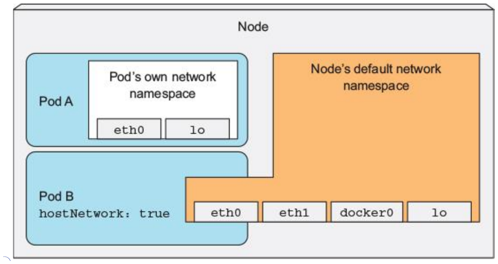
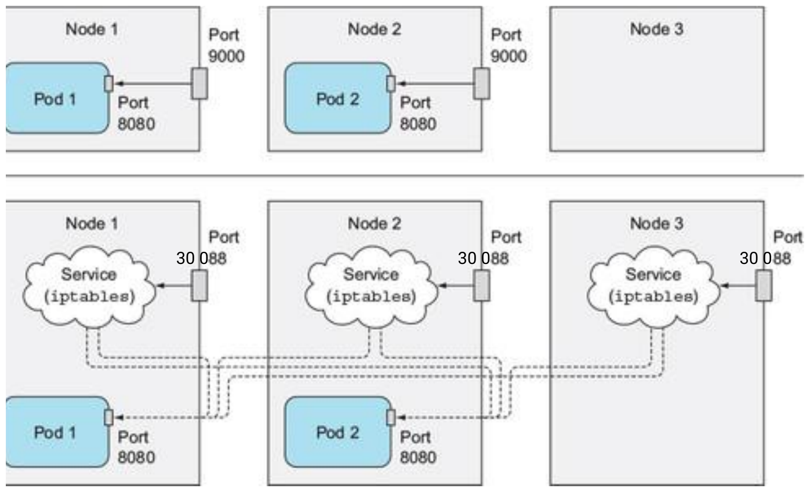
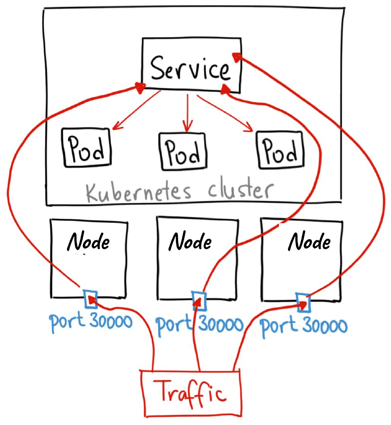
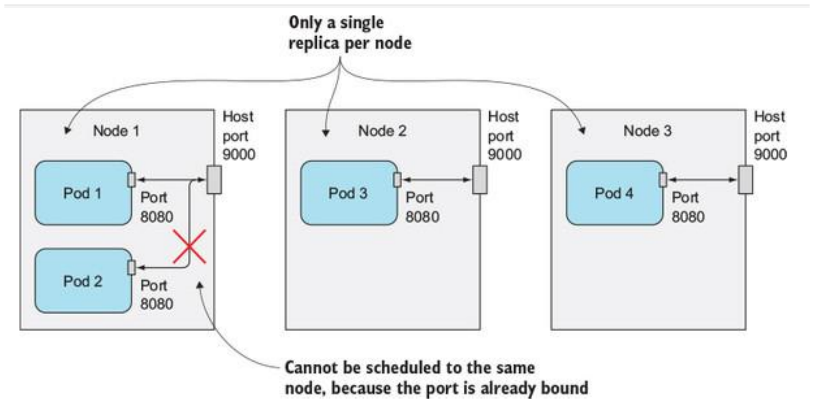
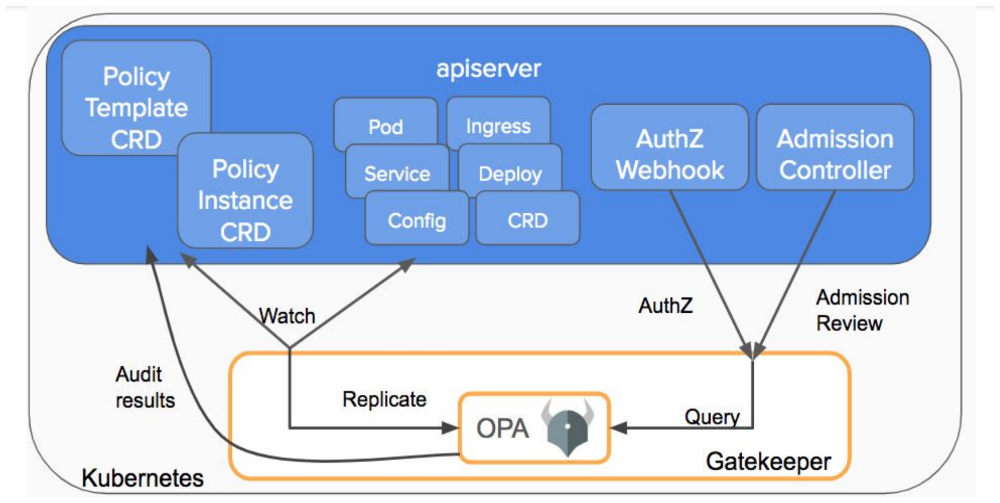
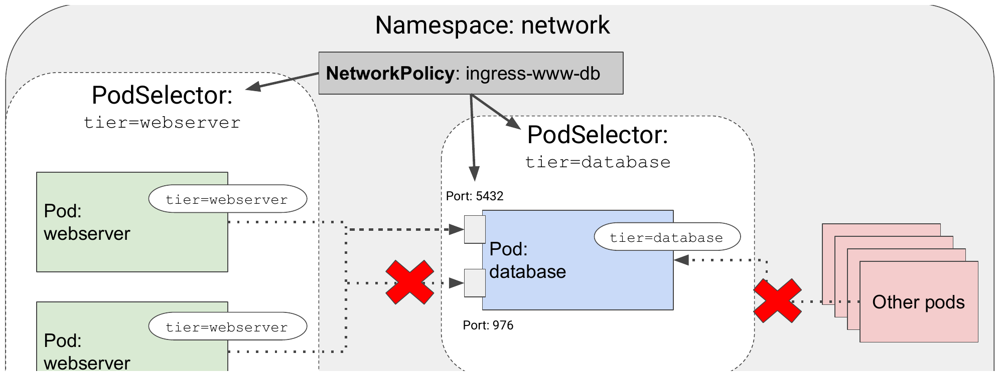
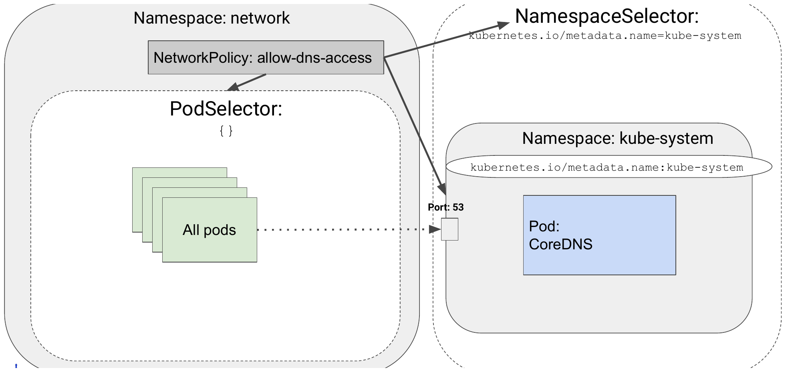
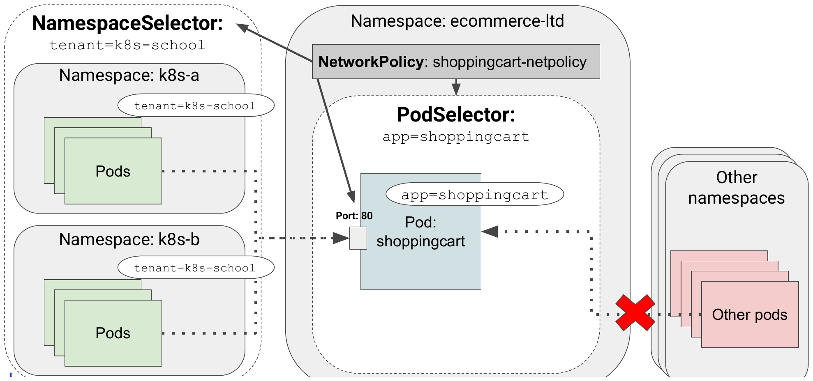

# Kubernetes beyond the basics

## Securing the nodes and the network


Fabrice Jammes, Karim Ammous, https://k8s-school.fr

---

## Securing cluster nodes and the network

- Using the node's default Linux namespaces in pods
- Running containers as different users
- Running privileged containers
- Adding or dropping a container's kernel capabilities
- Defining security policies to limit what pods can do
- Securing the pod network

---

## Using the node's network namespace in a pod

A pod with `hostNetwork: true` uses the node's network interfaces instead of its own.



---

## pod-with-host-network.yaml

```yaml
apiVersion: v1
kind: Pod
metadata:
  name: pod-with-host-network
spec:
  hostNetwork: true
  containers:
  - name: main
    image: alpine
    command: ["/bin/sleep", "infinity"]
```

```bash
kubectl exec pod-with-host-network -- ip addr
```

---

## Binding to a host port without using the host's network namespace

`hostPort` property: defined in the `spec.containers.ports` field

- **Top**: two pods using `hostPort`, only their node forwards port 9000
- **Bottom**: two pods behind the same `NodePort` service, every node forwards port 30088



---

## The NodePort Service

Simplest way to access a Pod from outside the cluster



---

## Host port: only a single pod instance can be scheduled to a node



---

## Binding a pod to a port in the node's port space

```yaml
apiVersion: v1
kind: Pod
metadata:
  name: kubia-hostport
spec:
  containers:
  - image: luksa/kubia
    name: kubia
    ports:
    - containerPort: 8080
      hostPort: 9000
      protocol: TCP
```

---

## Using the host's PID and IPC namespaces

```yaml
apiVersion: v1
kind: Pod
metadata:
  name: pod-with-host-pid-and-ipc
spec:
  hostPID: true
  hostIPC: true
  containers:
  - name: main
    image: alpine
    command: ["/bin/sleep", "infinity"]
```

---

## Processes visible in a pod with `hostPID: true`

```
$ kubectl exec pod-with-host-pid-and-ipc -- ps aux
PID   USER     TIME  COMMAND
    1 root      0:01 /usr/lib/systemd/systemd --switched-root --system ...
    2 root      0:00 [kthreadd]
    3 root      0:00 [ksoftirqd/0]
    5 root      0:00 [kworker/0:0H]
    6 root      0:00 [kworker/u2:0]
    7 root      0:00 [migration/0]
  ...
```

⚠️ The pod sees, and as root can signal, every process of the node.

---

# SecurityContext

---

## Understanding what's configurable in the security context

- Specify the user ID under which the process in the container will run
- Prevent the container from running as root
- Run the container in privileged mode, giving it full access to the node's kernel
- Configure fine-grained privileges, by adding or dropping capabilities, in contrast to giving the container all possible permissions with privileged mode
- Set SELinux, AppArmor or seccomp options to strongly lock down a container
- Prevent the process from writing to the container's filesystem

---

## Running a pod without specifying a security context

```
$ kubectl run pod-with-defaults --image alpine -- /bin/sleep infinity
pod/pod-with-defaults created

$ kubectl exec pod-with-defaults -- id
uid=0(root) gid=0(root) groups=0(root),1(bin),2(daemon),3(sys),4(adm),
6(disk),10(wheel),11(floppy),20(dialout),26(tape),27(video)
```

- User the container runs as: specified in the container image
- Dockerfile: see the `USER` directive. If omitted, the container runs as root

---

## Running a container as a specific user

```yaml
apiVersion: v1
kind: Pod
metadata:
  name: pod-as-user-guest
spec:
  containers:
  - name: main
    image: alpine
    command: ["/bin/sleep", "infinity"]
    securityContext:
      runAsUser: 405
```

```
$ kubectl exec pod-as-user-guest -- id
uid=405(guest) gid=100(users)
```

---

## Preventing a container from running as root

```yaml
apiVersion: v1
kind: Pod
metadata:
  name: pod-run-as-non-root
spec:
  containers:
  - name: main
    image: alpine
    command: ["/bin/sleep", "infinity"]
    securityContext:
      runAsNonRoot: true
```

- Prevents an attacker from pushing a root image under the same tag
- Running a process as root is a bad practice

---

## Pod gets scheduled but is not allowed to run

```
$ kubectl get po pod-run-as-non-root
NAME                  READY   STATUS                       RESTARTS   AGE
pod-run-as-non-root   0/1     CreateContainerConfigError   0          10s

$ kubectl describe po pod-run-as-non-root | grep Error
  Error: container has runAsNonRoot and image will run as root
```

---

## Running pods in privileged mode

Use protected system devices or other kernel features (example: kube-proxy in IPVS mode)

```yaml
apiVersion: v1
kind: Pod
metadata:
  name: pod-privileged
spec:
  containers:
  - name: main
    image: alpine
    command: ["/bin/sleep", "infinity"]
    securityContext:
      privileged: true
```

---

## Available devices: non-privileged vs privileged pod

```
$ kubectl exec pod-with-defaults -- ls /dev
core  fd  full  fuse  mqueue  null  ptmx  pts  random  shm
stderr  stdin  stdout  termination-log  tty  urandom  zero

$ kubectl exec pod-privileged -- ls /dev
autofs  bsg  btrfs-control  core  cpu  cpu_dma_latency  fd  full  fuse
hpet  hwrng  snd  sr0  tty0  tty1  tty10  tty11  ...  tty54  tty55 ...
```

Example: control the LEDs of a Raspberry Pi running [k3s](https://k3s.io/)

---

## Adding individual kernel capabilities to a container

- Linux supports a fine-grained permission system through kernel capabilities
- Instead of making a container privileged and giving it unlimited permissions, a much safer method is to give it access only to the kernel features it really requires
- See [capabilities(7)](https://man7.org/linux/man-pages/man7/capabilities.7.html)

```
$ kubectl exec pod-with-defaults -- date +%T -s "12:00:00"
date: can't set date: Operation not permitted
```

A container usually isn't allowed to change the system time (the hardware clock's time)

---

## Adding the `SYS_TIME` capability

```yaml
apiVersion: v1
kind: Pod
metadata:
  name: pod-add-settime-capability
spec:
  containers:
  - name: main
    image: alpine
    command: ["/bin/sleep", "infinity"]
    securityContext:
      capabilities:
        add:
        - SYS_TIME
```

---

## `date` command can now change the system time

```
$ kubectl exec pod-add-settime-capability -- date +%T -s "12:00:00"
12:00:00

$ kubectl exec pod-add-settime-capability -- date
Sun May  7 12:00:03 UTC 2017
```

⚠️ This changes the clock of the node: it may make your worker node unusable

---

## Dropping capabilities from a container

Example: the `CHOWN` capability

```
$ kubectl exec pod-with-defaults -- chown guest /tmp
$ kubectl exec pod-with-defaults -- ls -la / | grep tmp
drwxrwxrwt    2 guest   root   6 May 25 15:18 tmp
```

```yaml
    securityContext:
      capabilities:
        drop:
        - CHOWN
```

```
$ kubectl exec pod-drop-chown-capability -- chown guest /tmp
chown: /tmp: Operation not permitted
```

**Best practice**: `drop: ["ALL"]`, then add back only what is needed

---

## Preventing processes from writing to the container's filesystem

```yaml
apiVersion: v1
kind: Pod
metadata:
  name: pod-with-readonly-filesystem
spec:
  containers:
  - name: main
    image: alpine
    command: ["/bin/sleep", "infinity"]
    securityContext:
      readOnlyRootFilesystem: true
    volumeMounts:
    - name: my-volume
      mountPath: /volume
      readOnly: false
  volumes:
  - name: my-volume
    emptyDir: {}
```

---

## The container runs as root, but writing to `/` fails

```
$ kubectl exec pod-with-readonly-filesystem -- touch /new-file
touch: /new-file: Read-only file system

$ kubectl exec pod-with-readonly-filesystem -- touch /volume/newfile
$ kubectl exec pod-with-readonly-filesystem -- ls -la /volume/newfile
-rw-r--r--    1 root     root     0 May  7 19:11 /volume/newfile
```

**TIP**: `readOnlyRootFilesystem` is recommended in production

---

## Setting security context options at the pod level

In the previous examples the security context is set at the container level.

Several of these options can also be set at the pod level, in `pod.spec.securityContext`:

- They serve as a default for all the pod's containers
- They can be overridden at the container level
- The pod-level security context has additional properties (`fsGroup`, `supplementalGroups`, `sysctls`...)

---

## Sharing volumes when containers run as different users

- Volumes are used to share data between the pod's containers
- This works out of the box if all containers run as root

How to run 2 containers with different users using `runAsUser`?

Kubernetes allows to specify supplemental groups for all the containers of a pod with:

- `fsGroup`
- `supplementalGroups`

---

## `fsGroup` and `supplementalGroups`

```yaml
apiVersion: v1
kind: Pod
metadata:
  name: pod-with-shared-volume-fsgroup
spec:
  securityContext:
    fsGroup: 555
    supplementalGroups: [666, 777]
  containers:
  - name: first
    image: alpine
    command: ["/bin/sleep", "infinity"]
    securityContext:
      runAsUser: 1111
    volumeMounts:
    - name: shared-volume
      mountPath: /volume
```

---

## `fsGroup` and `supplementalGroups` (continued)

```yaml
  - name: second
    image: alpine
    command: ["/bin/sleep", "infinity"]
    securityContext:
      runAsUser: 2222
    volumeMounts:
    - name: shared-volume
      mountPath: /volume
  volumes:
  - name: shared-volume
    emptyDir: {}
```

- The first container runs as user ID 1111, the second as user ID 2222
- Both containers use the same volume

---

## `fsGroup` is used when the process creates files in a volume

```
$ kubectl exec -it pod-with-shared-volume-fsgroup -c first -- sh
/ $ id
uid=1111 gid=0(root) groups=555,666,777
/ $ ls -l / | grep volume
drwxrwsrwx    2 root     555      6 May 29 12:23 volume
/ $ echo foo > /volume/foo
/ $ ls -l /volume
-rw-r--r--    1 1111     555      4 May 29 12:25 foo
/ $ echo foo > /tmp/foo
/ $ ls -l /tmp
-rw-r--r--    1 1111     root     4 May 29 12:41 foo
```

---

## LAB: Security context

- [Security context](https://k8s-school.fr/labs/k8s/en/1_labs/security-context/index.html)

---

# Pod Security Admission

---

## PodSecurityPolicy is gone

- PodSecurityPolicy (PSP) was deprecated in v1.21 and **removed in Kubernetes v1.25**
- It is replaced by the built-in **Pod Security Admission** controller
- See [Migrate from PodSecurityPolicy to the Built-In PodSecurity Admission Controller](https://kubernetes.io/docs/tasks/configure-pod-container/migrate-from-psp/)
- For custom rules beyond the Pod Security Standards: a policy engine (Kyverno, OPA Gatekeeper) or `ValidatingAdmissionPolicy` (CEL, GA in v1.30)

---

## Pod Security Admission: much simpler than PSP

- Admission controller enabled by default since v1.23 (GA in v1.25)
- Applied to a namespace with labels, or cluster-wide
- Based on the [Pod Security Standards](https://kubernetes.io/docs/concepts/security/pod-security-standards/): `privileged`, `baseline`, `restricted`
- 3 modes:
  - `enforce`: pods that violate the policy are rejected
  - `audit`: violations are recorded as an annotation in the audit logs, the pod is allowed
  - `warn`: violations send a warning back to the user, the pod is allowed

```bash
kubectl label --overwrite ns my-ns \
  pod-security.kubernetes.io/enforce=restricted \
  pod-security.kubernetes.io/audit=restricted
```

---

## Cluster-wide policy

A default policy for all namespaces can be set at API server startup, with an `AdmissionConfiguration` passed to `--admission-control-config-file`:

```yaml
apiVersion: apiserver.config.k8s.io/v1
kind: AdmissionConfiguration
plugins:
- name: PodSecurity
  configuration:
    apiVersion: pod-security.admission.config.k8s.io/v1
    kind: PodSecurityConfiguration
    defaults:
      enforce: "baseline"
      audit: "restricted"
      warn: "restricted"
    exemptions:
      namespaces: [kube-system]
```

See [Enforce Pod Security Standards by configuring the built-in admission controller](https://kubernetes.io/docs/tasks/configure-pod-container/enforce-standards-admission-controller/)

---

## LAB: Pod Security Admission

- [Pod Security Admission](https://k8s-school.fr/labs/k8s/en/1_labs/pod-security-admission/index.html)
  - enforce `restricted` on a namespace and try to deploy a privileged pod
  - switch to `privileged` with warn/audit on `baseline`
  - make the pod compliant with `restricted`, with only `NET_BIND_SERVICE` added

---

# Policy engines

---

## OPA + Gatekeeper



*Gatekeeper v3.0 architecture, from the Kubernetes blog*

---

## OPA + Gatekeeper: simple example

See [OPA Gatekeeper: Policy and Governance for Kubernetes](https://kubernetes.io/blog/2019/08/06/opa-gatekeeper-policy-and-governance-for-kubernetes/)

- Define a `ConstraintTemplate`, which creates a Constraint CRD
- Then create ad hoc Constraints
- Examples: the [Gatekeeper library](https://open-policy-agent.github.io/gatekeeper-library/website/) re-implements the former PSP rules

---

## Exercise: consider policy based control organization

1. Determine what tools, if any, will be used to manage access policies
2. Who will be responsible for maintaining the policy: devops, system admins, the security team, or some combination?
3. Will the default policy be mostly closed, or open?
4. What is the process to allow a new permission? Who has final say?
5. Who is responsible for removing abilities no longer needed? How often will they check?

---

## Exercise: investigate Open Policy Agent

The Open Policy Agent is a graduated CNCF project.

1. Use the [Kubernetes primer](https://www.openpolicyagent.org/docs/latest/kubernetes-primer/) for examples and the [playground](https://play.openpolicyagent.org/) to experiment with some basic rules
2. Use the Kubernetes examples and create a rule which denies any image with the `latest` tag
3. Use the playground to check that the rule works as designed

---

# Namespaces

---

## Namespaces

**Problem**: I have too much stuff!

- name collisions in the API
- poor isolation between users
- don't want to expose things like Secrets

**Solution**: slice up the cluster

- create new Namespaces as needed: per-user, per-app, per-department, etc.
- part of the API, NOT private machines
- most API objects are namespaced: Namespaces are just another API object, part of the REST URL path
- one-step cleanup: delete the Namespace
- obvious hook for policies: quota, RBAC, PSA, NetworkPolicy

---

# NetworkPolicies

See:

- [kubernetes-network-policy-recipes](https://github.com/ahmetb/kubernetes-network-policy-recipes)
- [The NetworkPolicy resource](https://kubernetes.io/docs/concepts/services-networking/network-policies/#networkpolicy-resource)
- [Interactive editor](https://editor.networkpolicy.io/)

---

## Network isolation

- Describe the DAG of your app, enforce it in the network
- Restrict Pod-to-Pod traffic, or traffic across Namespaces
- Designed by the network SIG
- Enforced by the CNI plugin (Calico, Cilium, Antrea...): with a CNI that does not support them (flannel), policies are silently ignored

---

## Only some pods can access other pods, only on a specific port



---

## Add DNS access for all pods



---

## Only pods in namespaces matching a `namespaceSelector` can access a pod



---

## NetworkPolicy selectors

See [Behavior of `to` and `from` selectors](https://kubernetes.io/docs/concepts/services-networking/network-policies/#behavior-of-to-and-from-selectors)

```yaml
  ingress:
  - from:
    - namespaceSelector:
        matchLabels:
          tenant: k8s-school
      podSelector:          # same element: namespace AND pod
        matchLabels:
          app: client
```

```yaml
  ingress:
  - from:
    - namespaceSelector:
        matchLabels:
          tenant: k8s-school
    - podSelector:          # two elements: namespace OR pod
        matchLabels:
          app: client
```

---

## NetworkPolicy selection rule

Network policies do not conflict; they are additive. If any policy or policies select a pod, the pod is restricted to what is allowed by the union of those policies' ingress/egress rules. Thus, order of evaluation does not affect the policy result.

See [Network Policies](https://kubernetes.io/docs/concepts/services-networking/network-policies/)

---

## LAB: NetworkPolicy

- [NetworkPolicy](https://k8s-school.fr/labs/k8s/en/1_labs/networkpolicy/index.html)
  - deny all the ingress traffic
  - allow the webserver to reach the database
  - deny all the egress traffic, except DNS
  - AND or OR? `namespaceSelector` and `podSelector` combined

---

## What we have seen

- Pods can use the node's Linux namespaces instead of their own
- Containers can be configured to run as a different user and/or group than the one defined in the container image
- Containers can also run in privileged mode, allowing them to access the node's devices that are otherwise not exposed to pods
- Containers can run with a read-only root filesystem, preventing processes from writing anywhere but in mounted volumes
- The Pod Security Admission controller prevents users from creating pods that could compromise a node; it replaced PodSecurityPolicy, removed in v1.25
- OpenShift keeps its own mechanism, SecurityContextConstraints, alongside Pod Security Admission
- NetworkPolicy resources limit a pod's inbound and/or outbound traffic
