# OpenShift: differences with vanilla Kubernetes


Fabrice Jammes - [k8s-school.fr](https://k8s-school.fr)

---

# OpenShift CNI

---

## From OpenShift SDN to OVN-Kubernetes

- **OVN-Kubernetes** is the default network plugin since OpenShift 4.12
- **OpenShift SDN** was removed in OpenShift 4.17: clusters must migrate before upgrading
- OVN-Kubernetes also replaces `kube-proxy`: Services are implemented with Open vSwitch flows
- OpenShift Local (CRC) uses OVN-Kubernetes too:

```bash
oc get network.config cluster -o jsonpath='{.status.networkType}'
# OVNKubernetes
```

[A Deep Dive into OpenShift CNI: SDN, OVN, and More - MeatyBytes](https://meatybytes.io/posts/openshift/ocp-features/overview/core-foundations/networking/cni/)

---

# OpenShift deployment

---

## Managed or self-managed

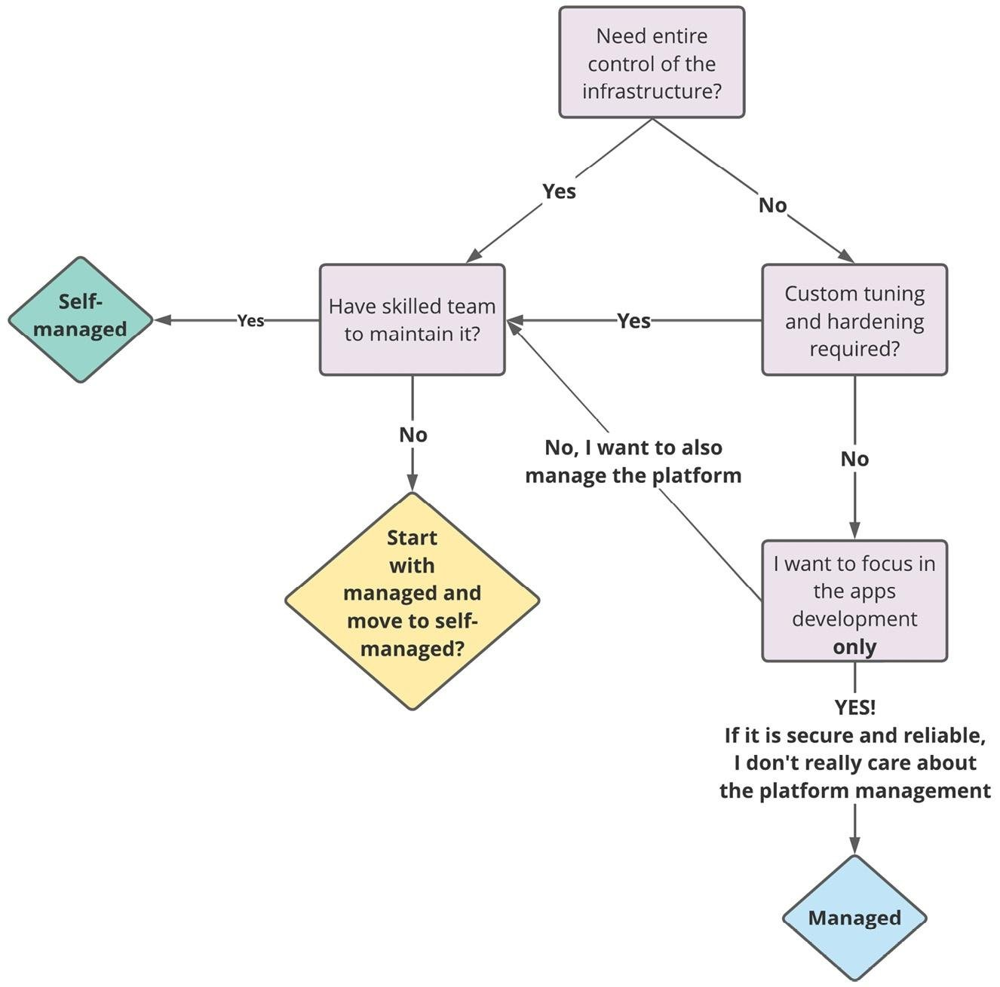

---

## The big picture

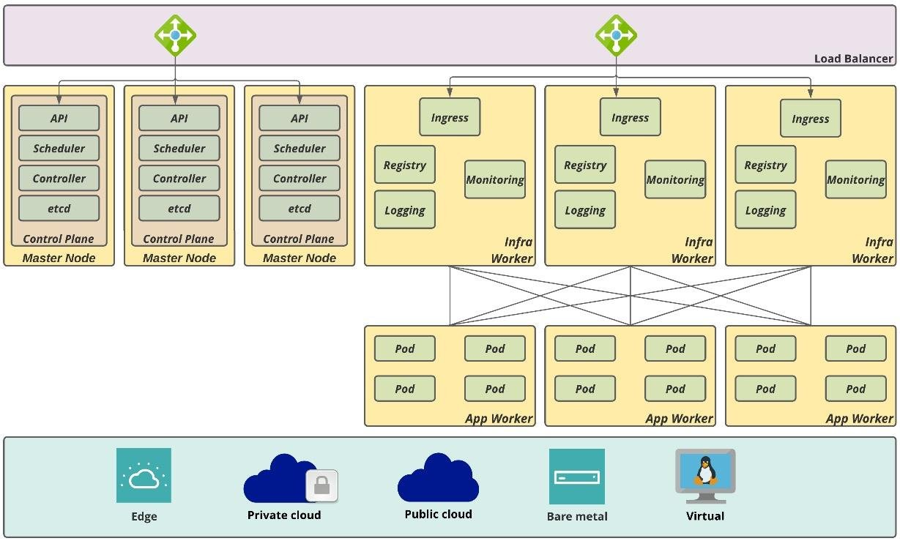

---

## On a node

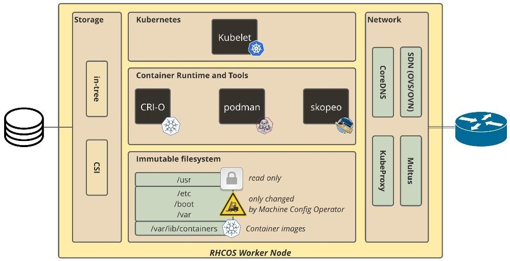

RHCOS: immutable OS, configured by the Machine Config Operator. CNI: OVN-Kubernetes.

---

## Installer-provisioned infrastructure (IPI, simple)

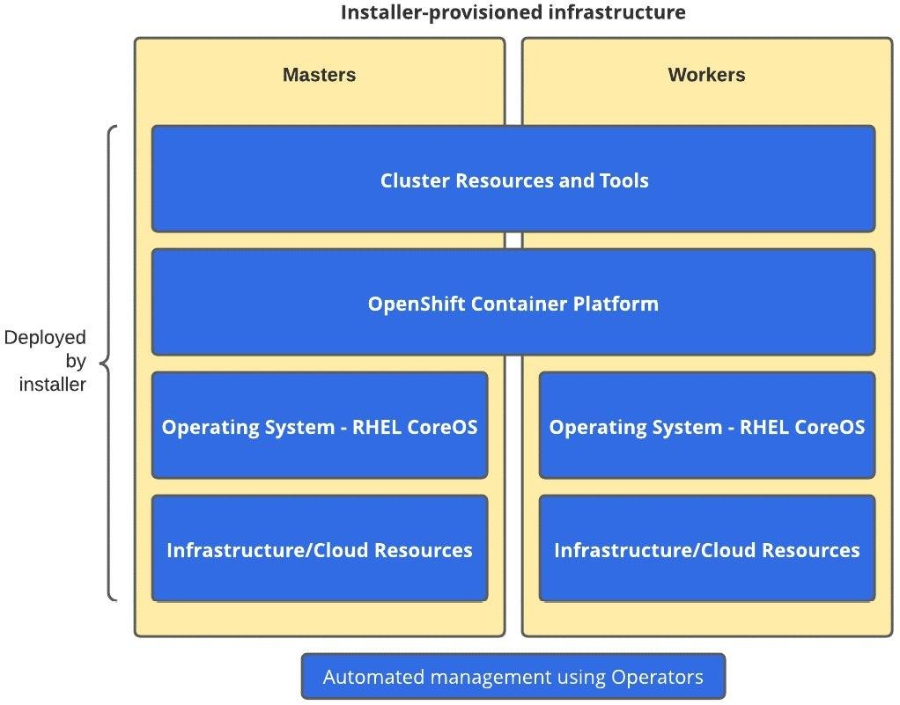

---

## Installer-provisioned infrastructure (IPI, simple)

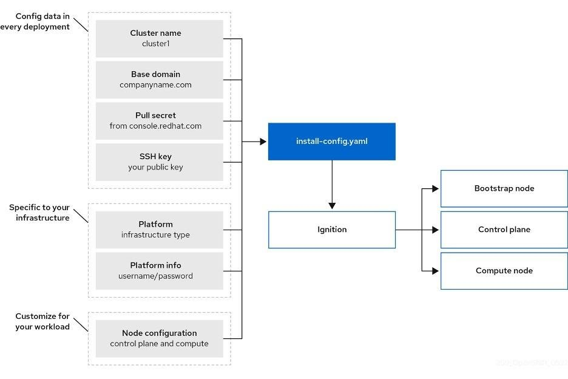

---

## Installer-provisioned infrastructure (IPI, simple)

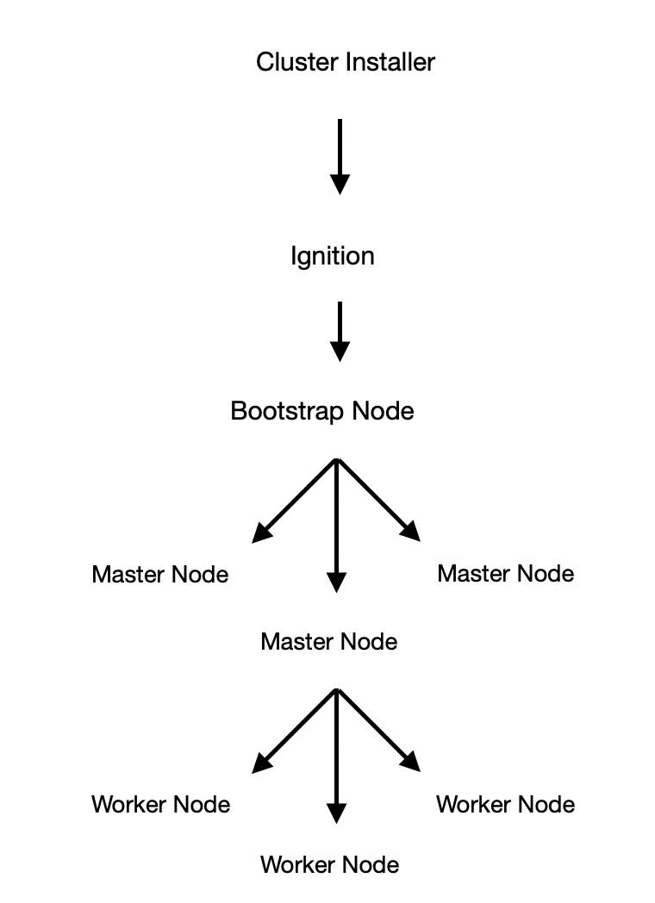

---

## IPI: demo on Azure

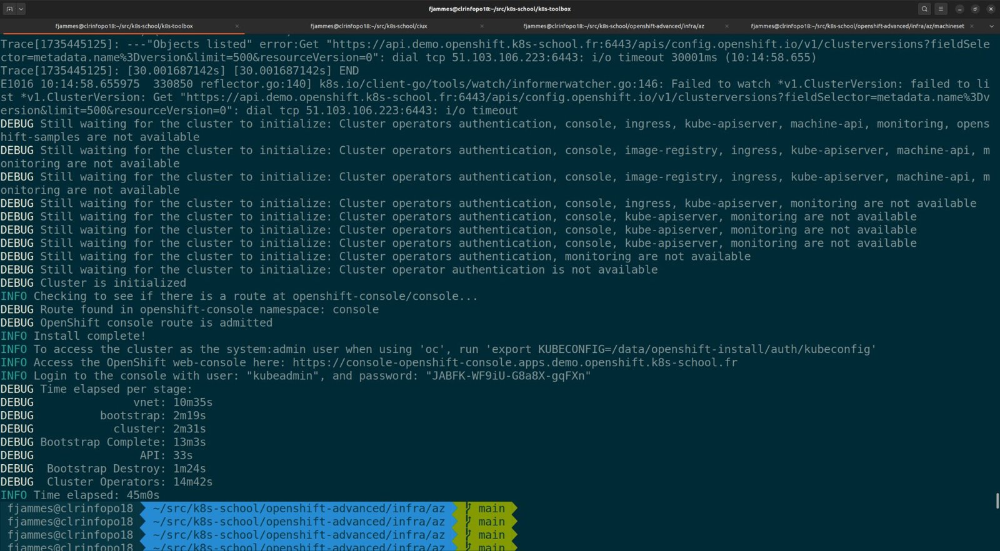

[Configuring an Azure account](https://docs.okd.io/latest/installing/installing_azure/installing-azure-account.html):

- Create an Azure subscription
- Make a quota request
- Configure DNS: [delegate a subdomain](https://learn.microsoft.com/en-us/azure/dns/delegate-subdomain)
- Create a service principal

Then run `openshift-install create install-config`, `openshift-install create cluster`, and wait:

---

## User-provisioned infrastructure (UPI, complex)

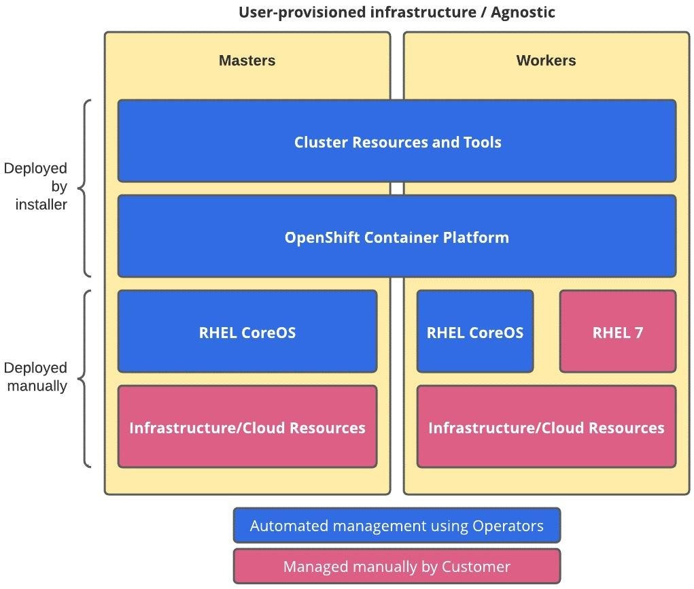

---

# OKD vs OCP vs OCP Plus

---

## OKD

OKD is a distribution of Kubernetes optimized for continuous application development and multi-tenant deployment. OKD is also the upstream code base of Red Hat OpenShift Container Platform (OCP).

> **Warning**: installing OKD on Azure failed, the FCOS images were not registered in Azure. The official documentation needs severe hacking on Azure: [Installing a cluster quickly on Azure](https://docs.okd.io/latest/installing/installing_azure/ipi/installing-azure-default.html)

---

## OpenShift Plus

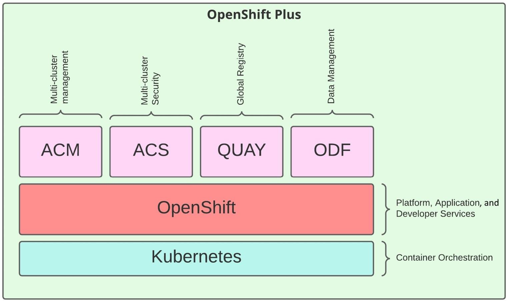

---

# Control plane

---

## Additional components

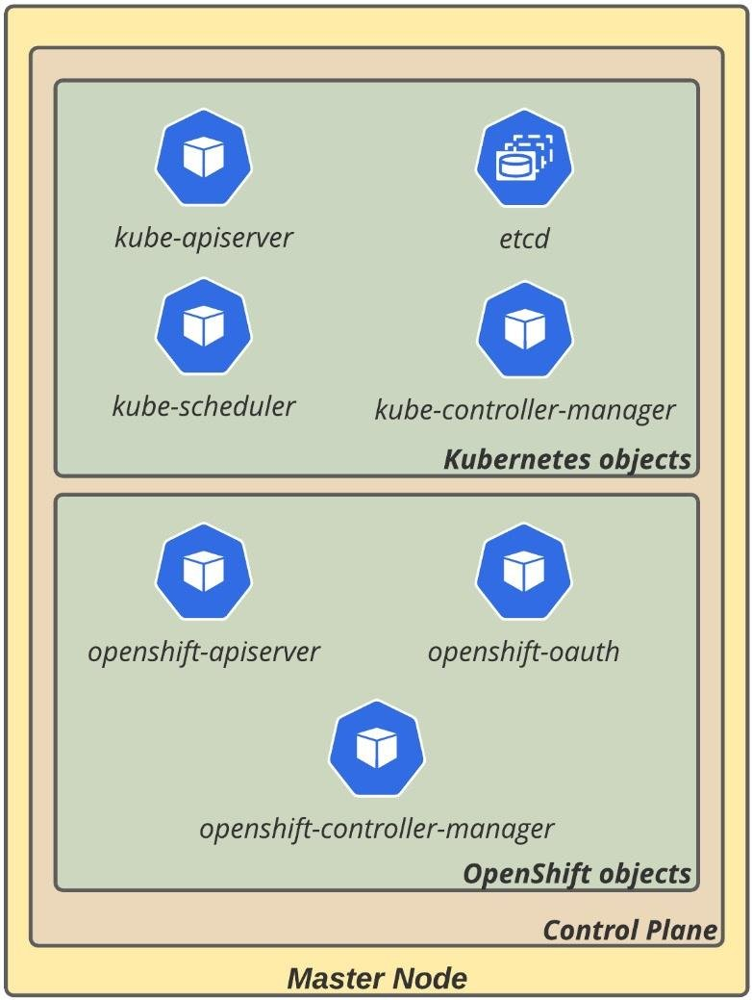

- **OpenShift API server** (`openshift-apiserver`): validates and configures the data of the OpenShift-only resources, such as routes, templates and projects
- **OpenShift controller manager** (`openshift-controller-manager`): makes the OpenShift-only resources reach their desired state
- **OpenShift OAuth server and API** (`openshift-oauth-apiserver`): validates and configures the data to authenticate users, groups and tokens

---

## Machine API

[Machine API Operator documentation](https://github.com/openshift/machine-api-operator)

- `MachineSet` → `Machine` → cloud VM → `Node`, like `ReplicaSet` → `Pod`
- One `MachineSet` per availability zone, created by the IPI installer
- Namespace `openshift-machine-api`

---

## Machine API

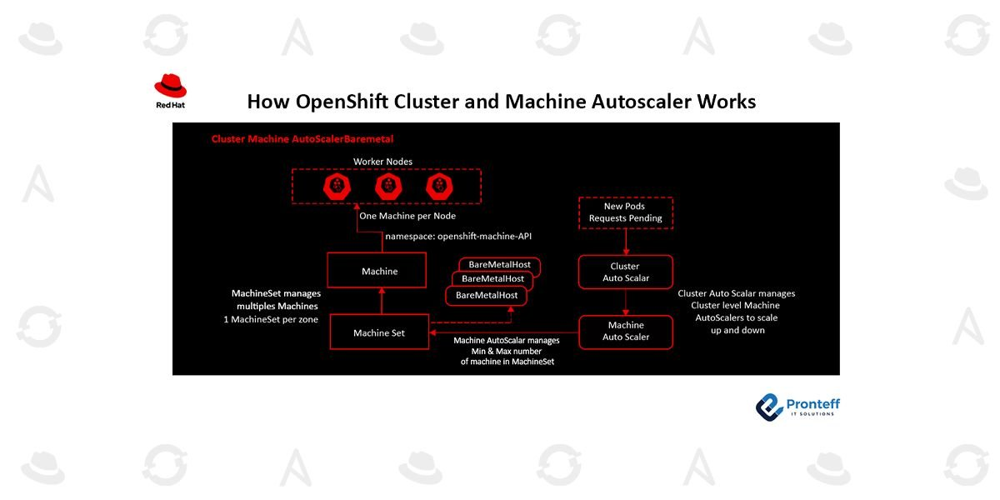

---

## Machine API: autoscaling

- [Cluster autoscaler resource definition](https://docs.okd.io/latest/machine_management/applying-autoscaling.html#cluster-autoscaler-cr_applying-autoscaling): one `ClusterAutoscaler` per cluster
- [Machine autoscaler resource definition](https://docs.okd.io/latest/machine_management/applying-autoscaling.html#machine-autoscaler-cr_applying-autoscaling): one `MachineAutoscaler` per `MachineSet`

---

## Lab: create a machine set

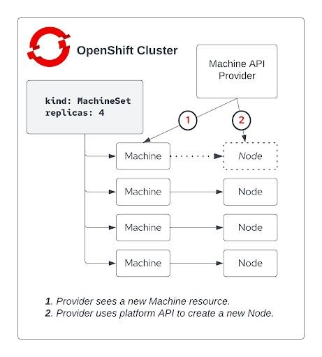

On the shared Azure IPI cluster:

- Create your `MachineSet` in a given zone
- Follow the `Machine` until its `Node` is ready
- Schedule a pod on it

Lab: [OpenShift MachineSets and availability zones](https://k8s-school.fr/labs/k8s/en/1_labs/openshift-machineset/index.html)

Doc: [Creating a compute machine set on Azure](https://docs.okd.io/latest/machine_management/creating_machinesets/creating-machineset-azure.html)

---

## Authentication

[Configuring an htpasswd identity provider](https://docs.okd.io/latest/authentication/identity_providers/configuring-htpasswd-identity-provider.html)

---

# RBAC

---

## RBAC

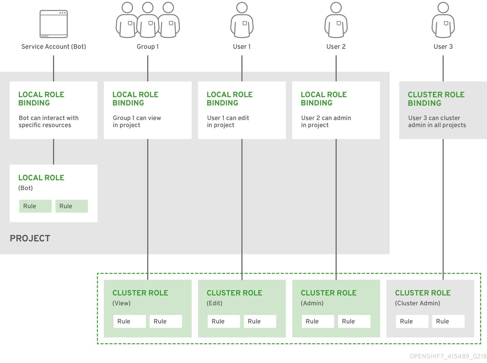

---

## RBAC

Create a group:

```bash
oc adm groups new <group>
```

Add users to a group and check:

```bash
oc adm groups add-users <group> <user1> <user2>
oc get group
```

Add a (cluster) role to a user in a project:

```bash
oc adm policy add-role-to-user <role> <user> -n <project>
```

See more: [Using RBAC to define and apply permissions](https://docs.okd.io/latest/authentication/using-rbac.html)

---

# SecurityContextConstraints (SCC)

---

## Restricting the use of security-related features in pods

`SecurityContextConstraints`:

- cluster-level resource
- defines which security features users can or cannot use in pods
- enabled in OpenShift

---

## What a SecurityContextConstraint can do

- Whether a pod can use the host IPC, PID or network namespaces
- The host ports a pod can bind to
- The user IDs a container can run as
- Whether a pod with privileged containers can be created
- The allowed, added by default and always dropped kernel capabilities
- The SELinux labels a container can use
- Whether a container can use a writable root filesystem
- The filesystem groups a container can run as
- The volume types a pod can use

---

## Workflow

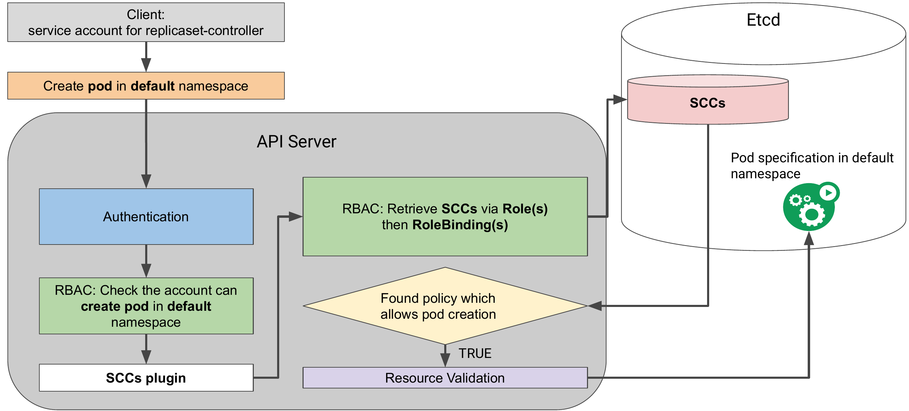

---

<!-- _class: lab -->

## Lab: Security Context Constraints

- Give a service account the RBAC rights to create pods, and see that it is not enough
- Find which SCC admitted a pod, and which SCC a pod requires
- Grant an SCC to a service account
- Understand why a Deployment needs the SCC on the **pod** service account

Lab: [OpenShift Security Context Constraints (SCC)](https://k8s-school.fr/labs/k8s/en/1_labs/openshift-scc/index.html)

---

## Operators across the industry

[OperatorHub.io: the registry for Kubernetes Operators](https://operatorhub.io/)

- Databases: PostgreSQL (CloudNativePG), MongoDB, Cassandra, Redis
- Messaging: Kafka (Strimzi)
- Monitoring: Prometheus
- Storage: etcd, Ceph (Rook, OpenShift Data Foundation)

On OpenShift, OperatorHub is built into the console, and the Operator Lifecycle Manager (OLM) installs and upgrades the operators.

---

# Questions?

Merci !

[@fjammes on GitHub](https://github.com/fjammes) - [k8s-school.fr](https://k8s-school.fr)
